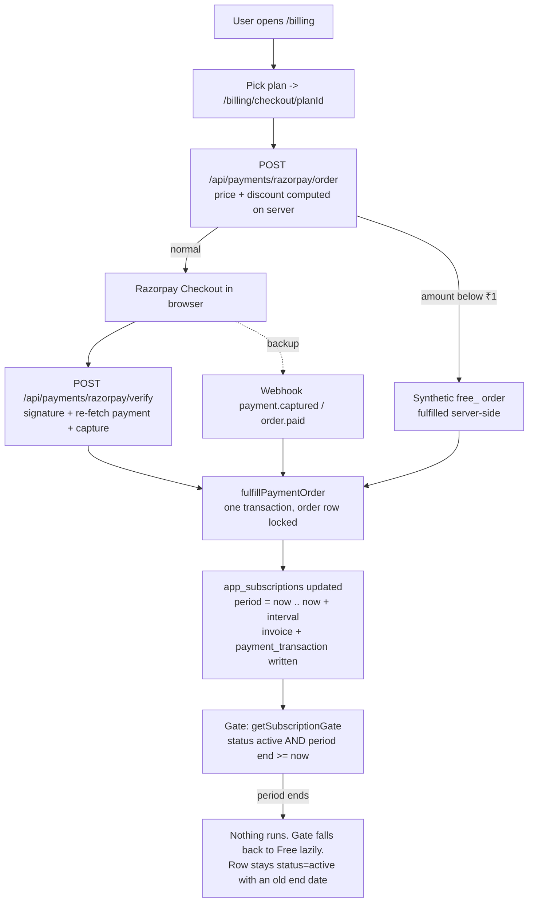
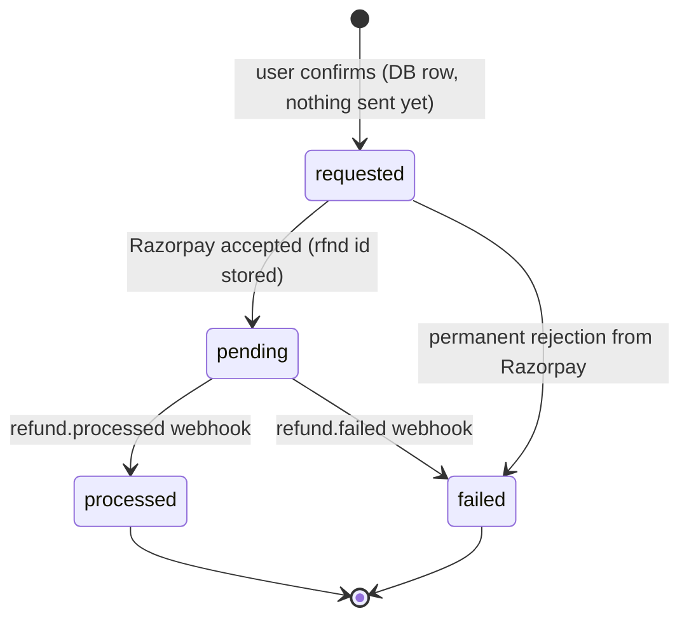
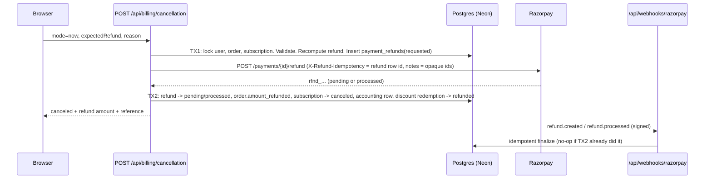

# Refund & Mid-Period Cancellation — Audit and Plan

**Status:** PLAN ONLY. Nothing has been implemented, migrated or changed in the app.
**Written:** 2026-11-15
**Scope:** Truvora's *own* paid plans (Free / Starter / Stroka Pro, monthly and yearly) sold through Razorpay.
**Not in scope:** the subscriptions a user *tracks* inside the app (Netflix etc.). See Appendix A for why, and what already works there.

> If "subscription" in your request meant the user-tracked subscriptions instead, tell me and I will re-plan; Appendix A explains that case in short.

---

## 0. Summary (read this first)

1. **Today there is no cancel and no refund anywhere in the app.** The `app_subscriptions` table has `cancel_at_period_end`, `canceled_at` and a `canceled` status, and `payment_transactions` has a `refund` type, but no code path ever writes them (apart from resetting them on purchase). `RAZORPAY_SETUP.md` §7, `PLAN_GUIDE.md` §7 and Terms §5 all say this is deliberately missing ("contact support").
2. **There is also a live money/entitlement gap right now, before any new feature:** if you refund a payment from the Razorpay dashboard, the app never finds out. The webhook only handles `payment.captured`, `order.paid` and `payment.failed`; everything else is acknowledged and ignored. The refunded user keeps the paid plan until the period ends.
3. **Truvora sells one billing period per payment. Nothing auto-renews.** So "cancel at period end" changes nothing financially (the plan simply ends). The only meaningful *mid-period* cancellation is **"cancel now, get the unused time refunded"**. That is what this plan builds.
4. **The refund must be computed from what the customer actually paid** (`payment_orders.amount_paid`), not the plan's list price. A referral discount or a ₹0 comped order changes the amount.
5. **Razorpay constraints that shape the design** (checked against Razorpay docs): refunds only on *captured* payments; partial and full refunds are supported; "normal" refunds take 5–7 working days; a normal refund is **not possible on a payment older than 6 months** (this matters for yearly plans); refund requests accept an idempotency header; webhooks exist for `refund.created`, `refund.processed`, `refund.failed`.
6. **Recommended build order (each step stops for your test and deploy):**
   Step 1 foundation (no visible change) → Step 2 refund webhooks + ops script (fixes gap #2) → Step 3 cancel-now + refund for users → Step 4 policy copy, plan-switch guard, payment history.

Decisions I need from you are in **§9**, each with a proposed default. "Approve with defaults" is enough.

---

## 1. How this audit was done

| Item | Status |
|---|---|
| Project folder read through the Filesystem tool (`C:\Users\HP\Documents\updated\truvora`) | Done |
| Files read in full: billing schema (`plans.ts`, `payment-orders.ts`, `appInvoices.ts`, `appTransactions.ts`, `platform-discount*.ts`, `users.ts`, `feature-usage.ts`, `schema.ts`), `lib/razorpay.ts`, `lib/payment-fulfillment.ts`, `lib/subscription.ts`, `lib/feature-access.ts`, `lib/upgrade-subscription.ts`, `lib/billing-period.ts`, `lib/money.ts`, `lib/account-deletion.ts`, `lib/rate-limit.ts`, `lib/active-subscription.ts`, `lib/subscription-renewals.ts`, `lib/subscription-cycles.ts`, `proxy.ts`, the order/verify/webhook/upgradeSub/plans/feature/export/subscriptions routes, the Clerk webhook, billing/checkout/success/failure pages, settings, terms, `scripts/plans.ts`, `scripts/update-user-plan.ts`, drizzle migrations 0016–0018, drizzle README, and the md docs | Done |
| Razorpay refund API / webhook facts | Checked against Razorpay documentation (Appendix C) |
| `tsc`, `lint`, `vitest`, `next build`, DB queries, Razorpay calls | **Not run.** This audit is code inspection only. Anything marked "appears" needs a quick confirm (e.g. a project-wide search) before it is relied on. |
| Live database contents (how many paid users exist, whether any rows violate assumptions below) | **Unknown.** Step 1 includes a read-only dry run to find out. |

Classification (per the Truvora reference doc): this is a **current requirement** (paid plans are live, so cancellation/refund handling is part of a reliable paid product). It is not a Phase 2 business feature, and it does not need workspaces. Billing is per user today; when Phase 3 workspaces arrive, plan ownership will move to the workspace, which is not designed here.

---

## 2. Current state (what exists today)

### 2.1 Billing lifecycle as implemented



### 2.2 What each piece already provides

| Piece | Where | Relevant facts |
|---|---|---|
| One row per user for plan state | `app_subscriptions` | Free tier = `provider: none`, period end +100 years (Clerk webhook). No unique constraint on `user_id`. Has `status` (incl. `canceled`), `cancel_at_period_end`, `canceled_at`, `current_period_start/end`, `plan_snapshot` (list price). |
| One row per Razorpay order | `payment_orders` | Unique `provider_order_id`, `provider_payment_id`, `receipt`. Has `amount`, `amount_paid`, `discount_*`, `status` (`created/attempted/paid/failed/canceled/expired`), `paid_at`. **No refund fields, no period fields.** |
| Invoice per paid order | `payment_invoices` | Status enum: `draft/open/paid/unpaid/void`. No refunded/credit-note concept. |
| Accounting rows | `payment_transactions` | Type enum already has `payment/refund/adjustment/chargeback`; status has `pending/succeeded/failed/refunded`. Unique `idempotency_key` (physical column is spelled `idemptency_key`; harmless, leave it). Only `payment` rows are written today. |
| Discount tracking | `platform_discount_redemptions` | Status enum already has `refunded`. `payment_order_id` and `amount_off` are never filled by fulfillment (only `status` and `redeemed_at`). One redemption per user, ever (unique `user_id`). |
| Idempotent grant | `lib/payment-fulfillment.ts` | Locks the order row, re-checks amount/currency, grants plan, writes invoice + payment row. A repeat call on a `paid` order is a no-op. |
| Provider client | `lib/razorpay.ts` | Create order, fetch payment, capture. Generic `RazorpayError` that drops the provider error code. **No refund call.** |
| Webhook | `app/api/webhooks/razorpay/route.ts` | Signature on raw body, size cap, zod schema. Handles 3 events; anything else → `{received, ignored}`. |
| Gate | `lib/subscription.ts` | Needs `status = 'active'` AND `current_period_end >= now`; otherwise falls back to the cheapest *free* active plan. |
| Per-user lock convention | Clerk webhook, `POST /api/subscriptions`, account deletion | `pg_advisory_xact_lock(hashtext(userId))`. **Not used by fulfillment.** |
| Rate limit | `lib/rate-limit.ts` | `sensitive` = 5/hour per subject. **Fails open** if Redis is missing or errors. |
| Same-origin guard | `proxy.ts` | Already applies to every mutating `/api/*` route that is not public. New authenticated routes need no allow-list change. |
| Daily crons | `vercel.json` | `subscription-renewals`, `subscriptionsTC` (reminders), `account-deletions`. All use `Bearer CRON_SECRET`. These handle *tracked* subscriptions, not Truvora's own billing. |

---

## 3. Findings

Severity uses your scale: **P0** critical, **P1** broken core flow, **P2** incomplete/sync/architecture, **P3** low. "Code-inspected" means read, not executed.

| ID | Sev | Finding | Evidence | Impact | Addressed in |
|---|---|---|---|---|---|
| **B-01** | P1 | No cancellation path. `cancel_at_period_end`, `canceled_at` and status `canceled` are never written (fulfillment only resets them). | `lib/payment-fulfillment.ts`, `db/schema/plans.ts`; no route under `app/api/billing` | Users cannot cancel; support must edit the DB by hand. | Step 3 |
| **B-02** | P1 | No refund path, **and refunds made in the Razorpay dashboard do not reach the app.** Webhook ignores `refund.*`. | `app/api/webhooks/razorpay/route.ts` (3 events handled, rest `ignored`) | Refunded customer keeps paid features until period end; DB and Razorpay disagree about money. Exists today. | Step 2 |
| **B-03** | P2 | "Current plan" is derived in five separate queries with different rules. The gate accepts only `active`; the billing page, checkout page, order route and the upgrade lib also accept `trialing`. Date comparisons differ (`>=` vs `>`, none in the upgrade lib). | `lib/subscription.ts`, `billing/page.tsx`, `checkout/[planId]/page.tsx`, `payments/razorpay/order/route.ts`, `lib/upgrade-subscription.ts` | Cancel/refund adds more states; without one definition the pages and the gate will drift. (Same pattern as the earlier F-04 "one active definition" fix.) Trials are unused today (`trial_days` 0), so the `trialing` mismatch is latent. | Step 1 |
| **B-04** | P3 | Expiry is lazy. Nothing flips an expired row; it stays `active` with a past end date. The gate then (correctly) gives Free entitlements, but the billing page shows "no plan" and does not highlight Free as current. | `billing/page.tsx` (`gte(currentPeriodEnd, now)` filter, `?? "no plan"`), `lib/subscription.ts` fallback | Confusing UI after expiry, and after any immediate cancellation (which would look the same). | Step 1 |
| **B-05** | P2 | Mid-period plan switching forfeits unused time, and **downgrades are allowed mid-period.** The order route only blocks buying the *same* plan; buying Starter while on Pro replaces Pro immediately. Fulfillment starts a fresh period from now. The code comment says "no proration yet". | `payments/razorpay/order/route.ts`, `lib/payment-fulfillment.ts` | Customer can lose paid time with no credit or refund. Directly related to mid-period cancellation. | Step 4 (guard); credit = future, see §10 |
| **B-06** | P2 (P1 once refunds ship) | No unique constraint on `app_subscriptions.user_id`, and every query uses `.limit(1)` without ordering. | `db/schema/plans.ts` | If a user ever has two rows, "the" row is arbitrary, so a cancel/refund could change the wrong one. Live data not checked. | Step 1 (dry-run check, then constraint) |
| **B-07** | P2 (P1 once refunds ship) | `fulfillPaymentOrder` takes no per-user advisory lock, unlike the other money/limit paths. It locks the order row, then updates the subscription row. A new cancel path that locks in the opposite order could deadlock or race. | `lib/payment-fulfillment.ts` vs Clerk webhook / `POST /api/subscriptions` | Concurrent purchase + cancel could leave the plan state and the money out of step. | Step 1 |
| **B-08** | P1 for refunds | Nothing links the *current period* to the payment that funded it, and `plan_snapshot.price` is the list price. A discounted or ₹0 order would be refunded the wrong amount if the snapshot were used. Fulfillment also never fills `platform_discount_redemptions.payment_order_id` / `amount_off`. | `payment-fulfillment.ts`, `platform-discount-redemptions.ts` | Over- or under-refund. | Step 1 (schema), Step 3 |
| **B-09** | P1 for refunds | `fulfillPaymentOrder` treats only `status = 'paid'` as "already processed". If order status were changed to a refunded value, a replayed `payment.captured` webhook would **re-grant the plan.** | `lib/payment-fulfillment.ts` (`order.status === "paid"`) | Refunded user gets the plan back. Avoided by design: keep order status `paid`; track refunds separately (§5.1). | Step 1 + test |
| **B-10** | P2 | Yearly plans vs Razorpay's 6-month limit on normal refunds. A prorated refund of a yearly plan after ~6 months cannot be created. | Razorpay docs (Appendix C) | Need an explicit rule instead of a failed API call. | Policy D2 |
| **B-11** | P2 | Account deletion deletes `payment_orders` (cascade) but keeps `payment_transactions` with identifiers nulled, matched via `subscriptions_id`. A refund accounting row without `subscriptions_id` would keep its Razorpay ids after deletion. A late refund webhook for a deleted user has nothing to match. The deletion verification list does not know about any new table. | `lib/account-deletion.ts` | Privacy/retention leak if not handled. | Step 2 |
| **B-12** | P2 | Copy promises "contact support" for cancellation/refunds and lists them as "not built". Checkout text says "automatic card mandates are not enabled". | `terms/page.tsx` §5, `RAZORPAY_SETUP.md` §7, `PLAN_GUIDE.md` §1/§7, `checkout/[planId]/page.tsx` | Must be updated *with* the feature, not before. `tests/plan-copy.test.ts` shows the pattern for guarding copy. | Step 3/4 |
| **B-13** | P3 | `lib/upgrade-subscription.ts` appears unused (its only caller, `/api/upgradeSub`, now returns 402). It also creates `open` proration invoices that nothing collects. | `app/api/upgradeSub/route.ts`, `lib/upgrade-subscription.ts` | Dead code that looks like a proration feature. Confirm with a project-wide search for `upgradeSubscription`, then delete. | Step 4 |
| **B-14** | P3 | After a downgrade (expiry today, immediate cancel later), editing an existing subscription that uses a *custom* category returns 403 "Upgrade your plan to use custom categories", even if the category is unchanged. Deactivating still works (separate PATCH shape). | `app/api/subscriptions/[id]/route.ts` | Surfaces more once cancel-now exists. | Step 4 (small fix) |
| **B-15** | P3 | Over-limit tracked subscriptions after a downgrade keep renewing and sending reminders; only creating/reviving is blocked. This is the current behaviour on natural expiry too. | `lib/subscription-renewals.ts`, `POST /api/subscriptions` | Acceptable, but should be a conscious decision (D4). | Decision only |

---

## 4. Product behaviour to build

### 4.1 What "cancel mid-period" means here

Because nothing auto-renews, there are only three possible actions:

| Action | Money | Access | Worth building? |
|---|---|---|---|
| **A. Cancel now and refund unused time** | Refund the unused part of what was paid | Ends immediately → Free | **Yes. This is the feature.** |
| B. Cancel at period end | None | Until period end, then Free | Not now. It would change nothing (the plan already ends). Keep the existing columns for when auto-renew exists. Show text "Your plan will not renew automatically and ends on {date}" instead. (D11) |
| C. End plan now, no refund | None | Ends immediately | Not offered. Only loses the customer's paid time. |

If you later add Razorpay Subscriptions (recurring mandates), action B becomes real (cancel at cycle end at the provider) and the existing `cancel_at_period_end` / `canceled_at` columns are ready for it.

### 4.2 Recommended refund policy (defaults, change as you wish)

1. **Full refund within 7 days of purchase** (of the amount actually paid), regardless of usage.
2. **After 7 days: prorated refund of unused *whole* days**, rounded down to the paisa.
3. **No refund** if the computed refund is below ₹10, or the period has ended, or the payment is older than ~170 days (Razorpay's 6-month limit with a safety margin). In those cases the UI says the plan ends on {date} and nothing is charged again.
4. **One refunded purchase per user per 90 days** (abuse guard against buy → export → refund loops).
5. **Referral/discount:** refund is based on the discounted amount paid. The discount redemption is marked `refunded` and is **not re-issued** (the table is one-per-user-ever).
6. **Fees:** Razorpay's own fee handling on refunds is not something I could confirm; check your Razorpay agreement. This plan assumes you absorb it and the customer gets the computed amount.
7. **Speed:** `normal` (5–7 working days). Instant ("optimum") has its own terms; leave it for later.

> Policy text shown to customers (Terms §5) should be reviewed by you or a lawyer. I am not a lawyer; Indian consumer rules may set minimums for refund/cancellation terms for paid online services.

### 4.3 Refund formula

```
paidPaise        = toPaise(payment_orders.amount_paid)            // after discount
refundedPaise    = toPaise(payment_orders.amount_refunded)        // normally 0
refundablePaise  = paidPaise - refundedPaise

totalDays        = round((periodEnd - periodStart) / 1 day)       // periods come from addBillingInterval, UTC
unusedDays       = clamp(floor((periodEnd - now) / 1 day), 0, totalDays)

if (now - paid_at) <= 7 days:
    refund = refundablePaise                                      // full-window refund
else:
    refund = floor(paidPaise * unusedDays / totalDays)            // BigInt, no floating point
    refund = min(refund, refundablePaise)

if refund < 10 rupees (1000 paise): ineligible
```

All arithmetic uses `BigInt` paise through `lib/money.ts`. No floating point.

Worked examples (UTC):

| Case | Paid | Cancel at | Result |
|---|---|---|---|
| Starter ₹129 monthly, paid 1 Nov, ends 1 Dec (30 days) | ₹129.00 | 4 Nov (day 3, inside 7 days) | **₹129.00** |
| Same plan | ₹129.00 | 16 Nov 12:00 (14.5 days left → 14 whole days) | 129 × 14 / 30 = **₹60.20** |
| Same plan with 20% referral discount | ₹103.20 | 4 Nov | **₹103.20** (not ₹129) |
| Stroka Pro Yearly ₹2,990, paid 1 Nov 2026, ends 1 Nov 2027 (365 days) | ₹2,990.00 | 15 Apr 2027 (200 days left) | 2990 × 200 / 365 = 1638.356… → **₹1,638.35** |
| Same yearly plan | ₹2,990.00 | 1 Jun 2027 (payment ~7 months old) | **Ineligible** (Razorpay 6-month limit). Plan ends 1 Nov 2027. |
| ₹0 comped order | ₹0.00 | any | No refund. Cancel-now still allowed? See D3 note: nothing to give back, so we just show the end date. |

---

## 5. Design

### 5.1 Data model (one migration, generated with `npm run db:generate -- --name refunds_and_cancellation`; never hand-written, per `drizzle/README.md`)

**`payment_orders` (add)**

| Column | Type | Notes |
|---|---|---|
| `amount_refunded` | `numeric(10,2) NOT NULL DEFAULT 0` | Running total. `CHECK (amount_refunded >= 0 AND amount_refunded <= amount_paid)` is the database-level over-refund guard. |
| `period_start`, `period_end` | `timestamp NULL` | The slice of time this payment bought. Set by fulfillment; backfilled for existing paid orders. Needed because the subscription row only holds one period. |

Order `status` is **not** extended. It stays `paid` forever (it describes the payment, not the refund). That keeps replayed `payment.captured` webhooks harmless (B-09).

**`app_subscriptions` (add)**

| Column | Type | Notes |
|---|---|---|
| `current_payment_order_id` | `uuid NULL → payment_orders(id) ON DELETE SET NULL` | The order funding the current period. Set by fulfillment. Refund/cancel always acts on this order. |
| `cancel_reason` | `text NULL` | Optional short enum-like value from the dialog (e.g. `too_expensive`, `not_using`, `missing_feature`, `other`). Not free text, to avoid storing personal data. |

Existing `status`, `canceled_at`, `cancel_at_period_end` are reused. (Optional: a partial unique index on `user_id` once the Step 1 dry run proves no duplicates, closing B-06.)

**New table `payment_refunds`** (workflow record; cascades with the user, like orders)

| Column | Type | Notes |
|---|---|---|
| `id` | uuid PK | Also used in the Razorpay idempotency key and notes. |
| `payment_order_id` | uuid NOT NULL → `payment_orders` ON DELETE CASCADE | |
| `user_id` | text NOT NULL → `users` ON DELETE CASCADE | |
| `app_subscription_id` | uuid NULL → `app_subscriptions` ON DELETE SET NULL | |
| `kind` | enum `full_window`, `prorated`, `external` | `external` = created in the Razorpay dashboard, discovered via webhook. |
| `status` | enum `requested`, `pending`, `processed`, `failed` | See state diagram. |
| `amount` | `numeric(10,2) NOT NULL CHECK (amount > 0)` | |
| `currency` | text | |
| `provider_refund_id` | text NULL, **unique** | `rfnd_…`. Replay protection for webhooks. |
| `speed_requested` | text | `normal` by default. |
| `calc` | jsonb | Inputs and result of the calculation (paid, period, now, unused days, policy version). For disputes. |
| `error_code` | text NULL | Provider error code only, never the raw body. |
| `requested_by` | enum `user`, `ops`, `provider` | |
| `processed_at`, `created_at`, `updated_at` | timestamps | |

Partial unique index: `UNIQUE (payment_order_id) WHERE status IN ('requested','pending','processed') AND kind <> 'external'` so a double click or two tabs cannot create two cancel-refunds for one order.

**Accounting row:** when a refund reaches `processed` (or is accepted), write one `payment_transactions` row: `type = 'refund'`, `status = 'succeeded'`, `subscriptions_id` **set** (so account deletion severs it, B-11), `invoice_id` of the paid order's invoice, `provider_transaction_id = rfnd_…`, `idempotency_key = 'razorpay:refund:<rfnd_…>'`. Invoice status is left `paid`; refund totals are derived from the accounting rows. (GST credit notes: see §10.)

**Discount redemption:** on refund of a discounted order set the user's redemption to `refunded`; also fill the missing `payment_order_id` / `amount_off` going forward (B-08).

### 5.2 States

Refund workflow:



Plan entitlement (after this work):

| Situation | `app_subscriptions` | Gate gives | Billing page shows |
|---|---|---|---|
| Free | `active`, far-future end | Free | Free, current |
| Paid, in period | `active`, end ≥ now | Paid plan | Plan + end date + "Cancel plan" |
| Paid, expired | `active`, end < now (lazy) | Free | **Free, current; "Your {plan} ended on {date}"** (fixes B-04) |
| Canceled now | `canceled`, `canceled_at` = now, `current_period_end` = now | Free | Free, current; "Canceled on {date}; refund ₹X ({status})" |
| Re-purchased later | fulfillment sets `active` again | Paid plan | Paid plan |

### 5.3 One definition of "current plan" (fixes B-03, B-04)

New `lib/billing-state.ts` exporting `getBillingState(userId, now)` that returns the plan, tier, whether it is paid, period dates, status (`free | paid | expired | canceled`), the funding order and refund eligibility inputs. `getSubscriptionGate`, the billing page, the checkout page and the order route all call it. Same idea as `lib/active-subscription.ts`: one condition, never re-written inline. Decide `trialing` once (default: treat it like `active`, since trials are not used).

### 5.4 Lock order (fixes B-07)

Every billing mutation (fulfillment, cancel, refund webhook, reconciler) takes locks in this fixed order, inside one DB transaction:

1. `pg_advisory_xact_lock(hashtext(userId))`  (same call the Clerk webhook and subscription create already use)
2. `payment_orders` row `FOR UPDATE`
3. `app_subscriptions` row `FOR UPDATE`

Network calls to Razorpay are **never** made while holding these locks.

### 5.5 Cancel-now flow



Rules:

- The client never sends an amount to refund. It sends `expectedRefund` only so the server can return **409 with the new amount** if the preview went stale (same pattern as the checkout "price changed" prompt).
- **Access is revoked when Razorpay accepts the refund request** (TX2), not when the money lands 5–7 days later. If Razorpay rejects the request, the plan is untouched.
- The same request can be retried safely: the idempotency key is derived from the refund row id (`rfnd-<uuid>`, which satisfies Razorpay's "10+ chars, letters/digits/hyphen/underscore" rule).
- Razorpay `notes` carry only opaque ids (refund row id, order id). No email, name or amount text.

### 5.6 API surface (all authenticated; none is public, so `proxy.ts` needs no change)

| Route | Purpose |
|---|---|
| `GET /api/billing/cancellation` | Preview. Returns eligibility, reason if not eligible, refund amount, the formula inputs in plain words, and the plan end date. |
| `POST /api/billing/cancellation` | Execute cancel-now. Body: `{ expectedRefund, reason? }` (strict zod). Rate limit: `sensitive`, subject `user:{id}:cancel`. |
| `GET /api/billing/payments` (Step 4) | Payment history: orders and refunds for the signed-in user only. |
| `POST /api/webhooks/razorpay` (existing) | Add `refund.created`, `refund.processed`, `refund.failed`. Ignore `refund.speed_changed`. |
| `GET /api/crons/refund-reconcile` | Daily safety net. Bearer `CRON_SECRET`; `/api/crons/*` is already public in `proxy.ts`. Add to `vercel.json` and `deploy/crontab.example`. |
| `scripts/refund-order.ts` | Ops tool: refund an order (full or partial) with the same service code, dry-run first. Avoids building an admin role/UI now (the project has no role system; `DISCOUNT_AUDIT.md` made the same point). |

### 5.7 Razorpay client additions (`lib/razorpay.ts`)

- `createRazorpayRefund({ paymentId, amountPaise, idempotencyKey, notes, speed }, config)` → `POST /payments/{id}/refund`, header `X-Refund-Idempotency`.
- `fetchRazorpayRefund(refundId)` and `fetchRazorpayPaymentRefunds(paymentId)` for reconciliation.
- `RazorpayError` gains a safe `code` (e.g. `BAD_REQUEST_ERROR`) and a `retryable` flag (network/5xx/409-in-progress vs permanent 4xx). The raw provider body still never leaves the server.

### 5.8 Webhook handling for refunds

`payload.refund.entity` (id, payment_id, amount, status, notes) plus `payload.payment.entity`.

1. Find our `payment_refunds` row by `notes.refundId`, else by `provider_refund_id`.
2. If none (a **dashboard-issued** refund): find the order by `payment_id = payment_orders.provider_payment_id`, create a `kind = external`, `requested_by = provider` row (unique `provider_refund_id` makes replays no-ops).
3. Apply in one transaction under the lock order: add to `amount_refunded` (CHECK protects), write the accounting row once.
4. **Entitlement rule for external refunds (D6):** a refund that brings `amount_refunded` to the full `amount_paid` ends the plan like cancel-now; a partial dashboard refund is recorded only.
5. `refund.failed`: mark the row `failed`, do **not** restore the plan automatically, log + email support (D9), show the user "refund failed, contact support".
6. No matching order (e.g. user already deleted): log, return 200 (Razorpay must not retry forever).

### 5.9 Reconciler (daily)

- `requested` for more than 10 minutes: retry the same Razorpay call with the same idempotency key, or look the refund up by payment id and notes. Then finish TX2.
- `pending` for more than 8 days: fetch status from Razorpay and settle it.
- Output a summary like `processSubscriptionRenewals` does (processed / settled / failed), supports `?dryRun=1`.

### 5.10 UI

- **Billing page, "Current subscription" card:** status line; "Cancel plan" button (paid and in period only). Expired and canceled states per §5.2. Fixes B-04.
- **Cancel dialog** (existing `ui/dialog.tsx`): shows plan, end date, the refund amount from the preview, and one plain sentence of the rule used ("Full refund: you paid 3 days ago" / "Refund for 14 unused days"). States what happens: moves to Free immediately; tracked subscriptions above the Free limit stay but you cannot add more (D4). Optional reason dropdown. Confirm button disabled while in flight. 409 "amount changed" prompt. Errors in `role="alert"`, status in `role="status"`, matching existing pages.
- **After cancel:** success card with refund reference and "arrives in 5–7 working days".
- **Payment history** (Step 4): small table of orders and refunds with a "Refunded ₹X" badge. Today users cannot see past payments at all.
- **Email** (Step 3, via existing Resend setup): refund confirmation, idempotency key `refund/<refundId>`; support alert on `refund.failed`.

### 5.11 Security and abuse

- Amounts only ever computed server-side; ownership by `userId` from Clerk on every query; order and subscription looked up by the pointer on the user's own row, never by an id from the client.
- Money-moving routes must not rely on the rate limiter, because it fails open without Redis. Safety comes from the DB lock, the partial unique index, the CHECK constraint, Razorpay's idempotency key and the 90-day cap.
- Feature flag `BILLING_REFUNDS_ENABLED` (default off), same fail-closed idea as `isRazorpayConfigured()`: the code can be deployed and the button stays hidden until you switch it on.
- Webhook: reuse the existing signature check, raw-body rule and size cap; add the refund payload to the zod schema. Subscribe the three refund events in the Razorpay dashboard (update `RAZORPAY_SETUP.md` §2).
- No provider bodies in logs or responses (existing rule in `lib/razorpay.ts`).

### 5.12 Failure modes

| What goes wrong | Result | Recovery |
|---|---|---|
| Razorpay permanently rejects (not captured, over-refund, too old) | TX1 effects rolled back to `failed`; plan unchanged; user sees a plain message | None needed |
| Timeout / 5xx on the refund call | Row stays `requested`; plan unchanged | Reconciler retries with the same idempotency key; webhook may finish it first |
| Razorpay accepted, our TX2 fails | Refund exists at Razorpay, DB still says `requested` | `refund.created` webhook (carries our id in notes) completes TX2 |
| Refund later fails at the bank | Row `failed`, plan already Free | Support alert; ops re-issues (script) or pays out manually. Documented in runbook |
| Double click / two tabs | Second request gets 409 "already in progress" | Partial unique index + advisory lock |
| Webhook delivered twice | No-op | Unique `provider_refund_id` |
| Replayed `payment.captured` after refund | Order is still `paid` → `alreadyProcessed`; no re-grant | Test required (B-09) |
| User buys a new plan right after cancelling | Allowed; fulfillment reuses the row | Lock order serialises it; cancel always targets `current_payment_order_id` |
| Account deleted mid-refund | Refund continues at Razorpay; local rows cascade; accounting row is severed | Late webhook logged and acknowledged |

### 5.13 Account deletion changes (B-11)

- Refund accounting rows are written with `subscriptions_id` so the existing severing step catches them.
- `payment_refunds` cascades from `users`; add it (and the accounting rows) to the "remaining data" verification list in `cleanupUserData`.
- Update the Settings and Terms §8 wording only if it mentions billing retention.

---

## 6. Rollout (stop after each step for your test and deploy)

Every step ends with: `npx tsc --noEmit`, `npm run lint`, `npm test`, `npm run db:generate` reports no drift, then `db:migrate:verbose` on a Neon branch before production.

### Step 1: Foundation (no visible change except B-04 wording)
- Read-only dry-run script: counts paid users, users with more than one `app_subscriptions` row, paid orders without a matching period, ₹0 comped orders. **I need this output before choosing between "add a unique index" and "clean up first".**
- Migration 0019: new columns and `payment_refunds` table (§5.1).
- Backfill script (dry-run first, like `backfill-sub-links`): `period_start/end` on paid orders, `current_payment_order_id` on active paid subscriptions; reports anything it cannot match.
- `lib/billing-state.ts`; gate, billing page, checkout page, order route use it.
- Fulfillment: take the user advisory lock, set `period_*` and `current_payment_order_id`, fill discount-redemption link and amount. Add the replay-after-refund test.
- Billing page: expired/Free display fix.

### Step 2: Refund webhooks and ops tool (closes B-02, the live gap)
- `lib/razorpay.ts` refund calls and richer errors.
- `lib/refund-fulfillment.ts`; webhook handles `refund.created/processed/failed`.
- `scripts/refund-order.ts` (dry-run default).
- Account-deletion changes (§5.13).
- You subscribe the refund events in the Razorpay dashboard. Test in Razorpay test mode by refunding a test payment from the dashboard and watching the plan end.

### Step 3: Cancel now + refund for users (closes B-01)
- `lib/refund-policy.ts` (pure calculation), `lib/refund-service.ts` (TX1 → Razorpay → TX2).
- `GET/POST /api/billing/cancellation`, dialog, success state, emails, reconciler cron, `BILLING_REFUNDS_ENABLED`.
- Terms §5 refund and cancellation wording, `PLAN_GUIDE.md`, `RAZORPAY_SETUP.md` §7, checkout copy, in the same change (B-12), with a copy-guard test in the style of `plan-copy.test.ts`.

### Step 4: Cleanup and related fixes
- Plan-switch guard (B-05, D12).
- Payment history table and `GET /api/billing/payments`.
- Allow editing a subscription whose custom category is unchanged after a downgrade (B-14).
- Delete `lib/upgrade-subscription.ts` after confirming it is unused (B-13).
- Optional partial unique index on `app_subscriptions.user_id` if Step 1 showed it is safe (B-06).

---

## 7. Test plan

Follows existing Vitest style (pure-function tests, mocked-route tests such as `ownership-checks.test.ts`).

| Test file (new) | Covers |
|---|---|
| `refund-policy.test.ts` | Formula table: day 0/3/7/8, mid-period, last day, expired, discounted, ₹0, month-end and leap periods, yearly after 6 months, rounding, minimum threshold, 90-day cap. |
| `razorpay-refund.test.ts` | Request path, body (paise), idempotency header, notes, error → `code`/`retryable` mapping, no raw body leakage. |
| `refund-webhook.test.ts` | Signature, each refund event, dashboard-issued refund, unknown payment, replay, **`payment.captured` replay after refund does not re-grant**, partial vs full external refund. |
| `billing-state.test.ts` | Free, paid, expired, canceled, re-purchased, `trialing`, two-row edge case. |
| `cancellation-route.test.ts` | 401, ineligible reasons, ownership, stale `expectedRefund` → 409, double submit, rate limit, flag off. |
| `refund-account-deletion.test.ts` | Refund rows severed/deleted, verification list updated. |
| Copy guard | Terms and plan text match the policy constants. |

Manual (Razorpay test mode and a Neon branch): full-window cancel, prorated cancel, dashboard refund, failed refund simulation, two parallel cancel requests, cancel during a new purchase, webhook replay, and account deletion after a refund.

---

## 8. Risks

- **Real money.** Mitigated by Razorpay test mode first, a Neon branch for migrations, the default-off flag, DB constraints, and step-by-step deploys.
- **Existing paid users with irregular data** (manual `update-user-plan`, comped orders, orders predating `period_*`). Step 1's dry run finds them; those users simply get "contact support" instead of self-serve cancel.
- **Migration history is fragile** (see `drizzle/README.md`: journal rebuilds, manual 0018 replacement). Use `db:generate`, idempotent statements where the project already does, and `db:migrate:verbose`.
- **Razorpay fee treatment and instant-refund terms** are unconfirmed; check your merchant agreement.
- **Legal/GST wording** needs your review.

---

## 9. Decisions needed (defaults = what I would build if you say "approve with defaults")

| # | Decision | Default |
|---|---|---|
| D1 | Refund policy | 7-day full refund, then prorated unused whole days, min ₹10, none if period ended (§4.2) |
| D2 | Yearly plans after ~6 months | No refund (Razorpay limit); plan runs to its end date |
| D3 | What "cancel" does when no refund is possible | Not offered; UI shows the end date and "no further charges" |
| D4 | Tracked subscriptions above the Free limit after cancel | Keep them, block adding/reviving; do not auto-deactivate |
| D5 | Referral discount after a refund | Stays consumed (marked `refunded`), not re-issued |
| D6 | Refunds made in the Razorpay dashboard | Full refund ends the plan; partial refund is recorded only |
| D7 | Refund speed | `normal` |
| D8 | Abuse cap | 1 refunded purchase per user per 90 days |
| D9 | Emails | Send refund confirmation to the user; alert support on `refund.failed` |
| D10 | Storage | New `payment_refunds` table (alternative: reuse `payment_transactions` only, less code but no workflow state or double-refund index) |
| D11 | "Cancel at period end" button | Skip until auto-renew exists; show "will not renew automatically" text |
| D12 | Switching plans mid-period | Block while a paid period is active; user cancels (with refund) then buys the new plan. Credit-based upgrade is future work |
| D13 | Feature flag | `BILLING_REFUNDS_ENABLED`, default off |

---

## 10. Out of scope / future

- **Razorpay Subscriptions (auto-renew)** and real "cancel at period end".
- **Credit toward an upgrade** (apply unused value to the next order instead of refunding and re-charging). Better UX and fewer fees than refund-then-buy; needs its own plan.
- **GST invoices and credit notes** for refunds (the docs already list GST invoices as not built). Ask your CA whether you must issue credit notes.
- **Admin UI / roles** for refunds. The ops script covers this until a role system exists.
- **Workspaces (Phase 3):** plan ownership will move from user to workspace; refunds will need to follow.
- **Instant (optimum-speed) refunds.**

---

## Appendix A: Tracked subscriptions (the user's own Netflix-style records)

Not part of this plan, but for completeness:

- **Mid-period cancellation already exists.** `PATCH /api/subscriptions/[id]` with `{ active: false }` sets `deactivated_at = now`. `planRenewals` / `isChargeableOn` then stop recording charges from that moment, and the subscription stops counting toward the plan limit and reminders (`lib/active-subscription.ts`).
- **Gaps, if you want them:** no way to set the cancellation *date* (it is always "now"), and no way to record "refund received from the provider" against a subscription (it could be an income transaction linked to the subscription). Both are small and separate from billing.

## Appendix B: File change map

**New:** `db/schema/payment-refunds.ts`, `drizzle/0019_*.sql` + `drizzle/meta/*` (generated), `lib/billing-state.ts`, `lib/refund-policy.ts`, `lib/refund-service.ts`, `lib/refund-fulfillment.ts`, `app/api/billing/cancellation/route.ts`, `app/api/billing/payments/route.ts`, `app/api/crons/refund-reconcile/route.ts`, `app/(dashboard)/billing/CancelPlanDialog.tsx`, `app/(dashboard)/billing/PaymentHistory.tsx`, `components/refund-email.tsx`, `scripts/refund-order.ts`, `scripts/backfill-payment-periods.ts`, `scripts/billing-dry-run.ts`, and the tests in §7.

**Changed:** `lib/razorpay.ts`, `lib/payment-fulfillment.ts`, `lib/subscription.ts`, `lib/account-deletion.ts`, `app/api/webhooks/razorpay/route.ts`, `app/api/payments/razorpay/order/route.ts`, `app/(dashboard)/billing/page.tsx`, `app/(dashboard)/billing/checkout/[planId]/page.tsx`, `db/schema/plans.ts`, `db/schema/payment-orders.ts`, `app/api/subscriptions/[id]/route.ts` (B-14), `app/(marketing)/terms/page.tsx`, `PLAN_GUIDE.md`, `RAZORPAY_SETUP.md`, `PROJECT_FEATURES.md`, `vercel.json`, `deploy/crontab.example`, `.env.example` (flag), `package.json` (script entries).

**Removed (after confirming unused):** `lib/upgrade-subscription.ts`.

**No change needed:** `proxy.ts` (new routes are authenticated; the cron path is already allowed).

## Appendix C: Razorpay facts used (from Razorpay's documentation)

- Refund endpoint: `POST /v1/payments/:id/refund`; amount in paise; omit amount for a full refund; partial refunds allowed.
- Refunds can only be made on payments in `captured` state.
- Default speed `normal`: customer receives money in 5–7 working days; `optimum` attempts instant.
- A normal refund is not possible for a payment more than 6 months old; refund status values include `pending`, `processed`, `failed`.
- Idempotent refunds: send `X-Refund-Idempotency` with a key of at least 10 characters (letters, digits, hyphen, underscore). Reusing a key with different parameters returns a conflict.
- Webhook events: `refund.created`, `refund.processed`, `refund.failed`, `refund.speed_changed`. Payloads include `payload.refund.entity` and `payload.payment.entity`.

Re-verify these against Razorpay's current docs before Step 2, since provider limits and fees can change.
